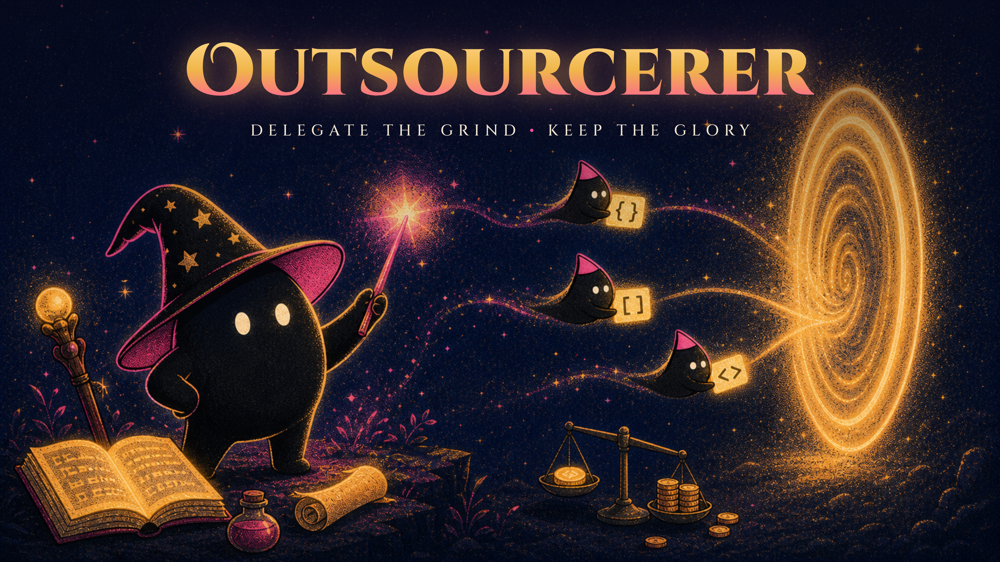

<div align="center">



[](https://github.com/alexgreensh/outsourcerer/releases)
[](https://github.com/alexgreensh/repo-forensics)
[](LICENSE)


### Your AIs, working as one team.

Outsourcerer is the orchestrator for every AI you already have. It splits the work, hands each piece to the right model in the right harness, keeps long jobs running, checks the results, and shows you the receipt.

</div>

---

You already have a fleet: Claude Code, Codex, Gemini, maybe Cursor or Devin, a stack of OpenRouter credits. Each is brilliant at something the others aren't, and they sit in separate rooms. **Outsourcerer gets them working as one team, with you as the boss.**

The session you're talking to becomes the lead. It hands the grind to a budget model, the hard calls to a frontier one, the private stuff to a model on your own machine, and brings your own skills along to whichever engine does the job. No server, no framework to learn. You just talk to it.

## Three things a router can't do

**It orchestrates.** One crew across Claude Code, Codex, Cursor, Droid, Antigravity, Devin, Hermes, Warp, Cline, Pi and even your Grok Bot. Specialists run side by side, advisors argue out a plan before anyone builds, and every job is watched until it ends with a clear result.

**It runs long.** A big job lives on disk as a plan, not in a chat. Close the laptop, lose the session, come back tomorrow: the plan picks up where it stopped. Decisions that are yours wait for you, and a watcher can wake you when something needs you.

**It proves the work.** Nothing grades its own homework. "Done" means your tests passed and the proof is saved. Reviews are tied to the exact build they approved, and merges land one at a time and get tested again.

And it saves you money and limits along the way. That's what happens when the grind stops running on your most expensive model. *(The [Tab](#the-tab-a-receipt-you-can-actually-believe) shows exactly how much.)*

---

## You talk. The sorcerer handles it.

No flags to memorize, no routing tables. You say what you want; it checks what you actually have installed, picks the right engine for each piece, and offers the cheap path before spending a cent it didn't have to.



If something isn't installed, it tells you the one command to fix it. You just say yes.

---

## What you can ask it to do

- **Run a whole build as a plan.** Advisors plan it, a worker builds it, another model reviews it, and it merges only after your tests pass on the result. Survives crashes and restarts. *(Its own section below.)*
- **Run agents in parallel.** Fan out a whole multi-agent gauntlet (a QA sweep, a per-module review, N reviewers) across any backend at once with `fanout`, watch them live, and collect every finding into one file. No 16-session bootstrap tax.
- **Convene advisors.** Have several stronger models review a plan or a diff in parallel, improve it, and only proceed on consensus.
- **Bring your setup along.** Hand the job your skills (`--with skills=x`, or `all`) and the delegate works with the whole skill - docs, references, scripts - on tool-capable harnesses; text-only lanes get the complete docs with executables honestly marked NOT TRANSFERRED. MCP servers on request (`--with mcp=`), on the Claude lanes, verified present before launch.
- **Loop it until it's green.** Try, check, try again on a cheap model, with *your* tests deciding when it's done. *(Its own section below.)*
- **Offload the grind.** Repo mapping, mechanical refactors, running the test suite, big searches. Cheap model does it; your main agent stays the boss.
- **Generate images.** **GPT-image first** on your Codex plan (keyless, no API credits), then nano-banana or an OpenRouter image model. *(Every illustration in this README was rendered exactly this way, by Outsourcerer, keyless, `$0` cash.)*
- **Review anything visual.** Screenshots, UI, design, handed to Gemini, keyless on your Antigravity login.
- **Run it on your own machine.** A local model on Ollama or LM Studio runs the job on your hardware: `$0`, no tokens burned, fully private. *(Its own section below.)*
- **Find the cheap seats.** Ask what's free or cheap right now across your platforms (`suggest`). It reads each catalog live, so it keeps up as new models drop (a fresh free model on Devin or OpenRouter shows up on its own).
- **See what you're saving.** The **Tab** shows real spend vs your frontier model, per lane.
- **Ban a model for good.** `exclude add fable` and it is never picked again, by you or by the router. (It can't see a model an engine picks silently on its own.)

All of it in plain language. The commands underneath are the sorcerer's, not yours.

---

## It doesn't just call another model. It brings your whole workshop.

When Outsourcerer hands a job to a different engine or harness, that engine doesn't show up empty-handed. Grant a skill and the delegate gets the skill's **whole bundle** - SKILL.md plus its references, scripts, and assets - staged on disk next to the job on tool-capable harnesses, and synced into the harness's skills home on Devin. Text-only lanes can't run scripts, so they get the skill's complete documentation serialized into the prompt, with every script and asset explicitly listed as NOT TRANSFERRED - and a grant that can't fit or resolve refuses the dispatch instead of arriving half-loaded. MCP servers come along when you ask for them (`--with mcp=`), on the Claude lanes today; anywhere a grant can't make the trip, Outsourcerer says so up front instead of letting the delegate pretend. It's the difference between borrowing a stranger's bare laptop and having your own, fully set up, wherever the work happens to run.

---

## Advisors: bring the big brains in, several at once


Delegation runs both directions. Push work *down* to a cheaper model to save money, or pull the **strongest** models *up* as advisors to make the work better, and not just one:

- **Convene a panel.** Spin up **several strong models in parallel**, one from each subscription if you like (say Sol on Codex, Fable on Claude, Hy3 on OpenRouter), to review a plan or a diff at the same time.
- **Act only on consensus.** Outsourcerer greenlights the work when the panel agrees; a split is the signal to bring the decision back to you.
- **Improve, don't just grade.** Ask the advisors to rewrite the weak parts and fold in each other's fixes, not merely flag them.



A second, differently-wired head at the right moment is where the real leverage is. Three of them, agreeing, is even better.

---

## Run a whole crew at once


Outsourcerer runs the whole summoning itself. It decides what to delegate, picks the lane and model on live benchmarks, keeps every delegate interactive and steerable, supervises the fleet, and refuses to end a turn while work is live and waiting on you. The orchestrator contract lives in the skill, so the session you talk to owns the plan and the outcome rather than handing choices back to you.

**It also works underneath an orchestrator you already have.** Point yours at Outsourcerer and keep it: your orchestrator decides what to delegate and how results get approved, and Outsourcerer runs the assignments. It dispatches each specialist across any provider, then watchdog-supervises every job through to a **classified** end (done / blocked / timed-out) instead of a silent exit, salvages the recoverable ones with a bounded verify→retry loop, tracks the spend, and hands the results back as parsable state. Not just a router: a layer that dispatches, verifies, and accounts for every delegate, whoever is casting.

**Your Grok Bot can join the crew (beta).** Grok Bot has no chat API, but its routines take a webhook. Give Outsourcerer the webhook and `--provider grokbot` hands the bot a task. The bot works on its own cloud computer, pushes a branch to your repo, and Outsourcerer brings the result back. Nothing merges until you say so. The repo also ships a Cursor plugin manifest, so a bot can install Outsourcerer and hand work to the lanes set up on its computer. This direction is new and not yet proven on a live bot.

**Point it at any agent library and it just works.** A folder of role definitions, your own or a library like [agency-agents](https://github.com/msitarzewski/agency-agents), runs as a squad with `fanout --agents ./crew`, one supervised job per specialist. You never have to edit those files. The whole crew runs on a sensible cheap lane by default, and you add routing only if you want it, three ways, editing files last:

- **Nothing.** Any library runs unmodified on the default lane, one receipt, one `status --json`.
- **A one-line name map.** `--route 'security-*=glm-5.2, *architect*=sol, *=haiku'` sends each specialist to its own engine by name, no file edits.
- **Frontmatter**, if you own the files: `model:` / `effort:` / `lane:` per agent.

Precedence is unambiguous: global `-m` wins, then `--route`, then frontmatter, then the default. `--task "..."` drops your task into every role, so a pure library of personalities runs against your repo with zero edits.

```bash
outsourcerer fanout --agents ./engineering --route 'security-*=glm-5.2, *=haiku' --task "audit auth" --worktree
outsourcerer fanout status <id> --json      # squad state as a stable JSON envelope your code parses
outsourcerer fanout collect <id>            # every result in one place, then: outsourcerer cleanup <id>
```

`--worktree` runs each editing specialist in its **own disposable git worktree** so parallel edits never collide; worktrees are preserved after the run (never auto-deleted), and `cleanup` refuses to bin one that has unmerged work unless you `--force`. Every job is watchdog-supervised so it ends **classified** (done / blocked / timed-out), carries your skills via `--with` (MCP on the Claude lanes), and lands on the **Tab**. You keep the persona, the decomposition, the merge policy; the sorcerer runs the fleet.

**It wakes you when a job ends.** Every launch prints a `wait` line. Start it as a background command and Claude Code or Codex gets a turn the moment the work finishes, with the result in hand. **On the roadmap:** pushed completion events for chat bots, and a richer receipt (cost + branch/SHA) in that same JSON.

---

## Big jobs that outlive the chat

Big jobs are a chain of steps: map the code, decide the approach, build it, review it, merge it. Keep that chain in one chat and it's gone the moment the session ends. Outsourcerer keeps it on disk as a **plan**, so the work survives crashes, restarts, and tomorrow morning.

One run, start to finish:

> *"Add per-user rate limiting. Plan it out and build it."*

- Two advisors on different models (say Sol on Codex and Opus on Claude) work out an approach **at the same time**, and a third folds the best of both into one plan.
- A budget model builds it in its own git worktree, and it isn't done until your tests pass.
- A different model checks the build against the plan. FAIL sends it back with the reason, PASS moves on.
- The change merges, your tests run again on the merged result, and you get the receipt.

That's `council-build`, one of the ready-made shapes. A real plan is wider than one line of steps: anything that doesn't wait on something else runs **side by side**, each on its own engine, in its own worktree. Three features at once, a reviewer per feature, a scout mapping the next one. What makes it hold up:

- **Every worker starts briefed.** It gets the spec, what the steps before it found, and the calls you made along the way.
- **"Done" means proven.** A worker saying it's finished doesn't count. Code needs real commits, your tests passing and a clean secret scan, and the proof is saved.
- **Your decisions are part of the plan.** "Pick the winner" or "approve this migration" becomes a step that waits for you, then passes your answer downstream. Give it a default and a deadline, and a plan left running goes ahead with the default if you're away.
- **Retries fit the failure.** A network blip retries the same model, a broken model moves to the next one on the list, and a run that was too big is retried as a smaller piece. The same failure twice comes to you for a re-plan.
- **Merges wait their turn.** Work lands one change at a time, your tests run again on the merged result, and your uncommitted edits are never touched.
- **More shapes.** `spec-build` writes a spec, plans it, builds it and checks it against the spec. `best-of-n` has several models build the same thing side by side, compares them, and lets you pick the winner.

```bash
outsourcerer plan new rate-limit --repo .
outsourcerer flow run council-build --plan rate-limit --var goal="Add per-user rate limiting" --var check="make test"
outsourcerer plan run --plan rate-limit  # run it again any time to pick up where it stopped
```

You will rarely type these. Say "plan this out and build it" and the sorcerer sets it up. The full guide is in [`references/factory.md`](plugins/outsourcerer/skills/outsourcerer/references/factory.md).

**Worktrees are not a security sandbox.** They keep files apart, but a worker on a lane without an OS sandbox runs with your user's rights, including outside its worktree. Use sandboxed verbs and lanes for untrusted work.

---

## Loops: send the laps somewhere cheaper


Loops are not new. Claude Code has them and they work. What is expensive is **who runs the laps**.

A loop is the same few moves over and over: try it, check it, try again. That is the least interesting work in software and the most repetitive, and if your frontier model is doing it, you are paying archmage rates for someone to re-run your test suite.

So the sorcerer sends the laps somewhere cheap and keeps the judgment. A budget model does the trying. **Your** tests do the checking. The archmage decides what "done" means and reads the result when it lands.

Nothing grades its own homework. The check is a real command, your suite, your build, your linter, because a model asked whether it succeeded will say yes.

And "loop" is not one shape. Build-until-the-tests-pass is the one everybody knows. It is not the only one worth sending away:

- a machine can settle it, so it runs until the check goes green
- you do not know how much work is in there, so it sweeps until nothing is left
- nothing can check it, but you can tell good from bad, so it tries several ways and keeps the best
- quality is a matter of degree, so one model drafts and another critiques until it stops improving
- the *plan* is the risky part, so two advisors argue it out before a cheap model touches a file

You will not type any of it. Describe the problem and the sorcerer picks the shape and offers it:

> *"That's a build-until-the-tests-pass job. Want me to hand it to GLM and keep re-running your suite until it's green? I'll stop if it stalls, or after twenty minutes."*

Yes is the whole interface. And it will talk you *out* of a loop when there is nothing that can verify the result, because at that point a loop is just a model marking its own homework in a circle.

While it runs, you can watch it: which attempt it is on, how long it has been going, and what is still failing. A loop you cannot see inside is a bet, not a tool.

It stops when the check goes green. It stops when the same failures come back twice, because a loop that is not converging is an expensive way to be wrong. It stops when the time you gave it runs out. It even stops when the *check itself* hangs, which used to be the one way a bounded loop could quietly run forever.

And stopping early is not a dead end. It keeps the task, the check, and the exact thing that broke last, so you can send it back around from where it stopped instead of paying twice for ground it already covered.

---

## See your whole fleet in one honest view


**Your AI sessions work in separate rooms.** A Claude Code tab here, three jobs you handed to cheaper engines there, one of them quietly waiting on your approval. Every tool shows you its own sessions. None of them show you all of them at once. `fleet` does.

```bash
outsourcerer fleet ls      # every session you're running, one honest list
outsourcerer fleet name    # real names from real work, not "session-a3f2"
outsourcerer fleet show <id>
```

**One list, and it tells the truth.** Every Claude Code session plus every job Outsourcerer ran for you, each with a status read from the live process and its own transcript, never a spinner that lies. A session is **Working**, **Waiting on you**, **Done**, or **Stopped mid-task**, so you walk straight to the one that needs you instead of hunting through tabs.

**Real names, not hashes.** `fleet name` reads what each session is actually working on and names it, so `session-71` reads as `Refactor the auth retry path`, cached so the list stays instant.

**It catches the stuck ones, and it reaches you.** Turn on supervision and a background heartbeat watches the fleet, spots a delegate that stalled, never started, or drifted off its pinned model, and either bounds it or **wakes you** through a notifier you set (`OSRC_HEARTBEAT_WAKE`) instead of letting it sit silent for half an hour. The heartbeat verifies its own liveness: it reports itself **armed** only when a real watcher is proven running by pid and start-time, and says so loudly when it is not, so "supervised" never quietly means "unwatched".

Today it covers your Claude Code sessions and the jobs Outsourcerer runs. Seeing sessions other tools launched on their own is next.

---

## You decide how much you drive

The first time it wakes up in a session, Outsourcerer shows you what's ready, how much of your token budget is left, and asks one question: how do you want to drive?

- **Auto-pilot.** It takes the wheel. Picks the engine, offloads the grind, conserves your limits, and just tells you what it did. For when you want the work done, not the decisions.
- **You-drive.** Nothing moves without your say-so. It proposes, shows you the cost, and waits. For when the call is yours to own.
- **Hybrid.** You agree once on what it can handle alone (tests, repo-mapping, the mechanical stuff), and it asks about everything else. The sweet spot most people settle into.

Pick once and it remembers. Change your mind in plain language any time ("take the wheel", "ask me first"). And no mode is a trap: safety, cloud consent, and your sign-off on anything risky hold in all three. Beginners aren't dropped at a command line, they're handed a steering wheel and told what each pedal does.

---

## Smart about every pick, and every penny

You're already smart about this. Even inside Claude Code you hand the small stuff to Sonnet instead of Opus. Outsourcerer takes that instinct across every engine you have: the right model for each job, prompted the way that model likes, without burning through the limits you need for the hard calls.

### It knows which model is actually worth it

You shouldn't have to memorize which model is best at what, or keep up with a leaderboard that shuffles every week. Ask Outsourcerer to pick, and it does the homework for you: it reads what the task really is (code? reasoning? a quick errand?), pulls **live benchmark scores** for every model you can reach, weighs quality against what each one actually costs you, and recommends the best *value* for this job, not just the most famous name.

That means a frontier-grade answer on a budget lane when the cheap model genuinely clears the bar, and a premium model only when the task truly earns it. It shows you the score and the reason it chose what it chose, so the pick is never a black box, and you can always overrule it. When it can't reach the live boards, it falls back to a built-in capability map, so the recommendation is never worse than a good default.

This is the same brain your **copilot** uses to choose. In auto-pilot it scores the models, takes the best value, and just proceeds (telling you which and why). In you-drive or hybrid it scores them the same way, then shows you the pick and waits for your nod. The benchmarks drive the choice in every mode; the mode only decides whether it asks first.

### One spell, tailored to each model


The models don't think alike, so Outsourcerer doesn't prompt them alike. The right prompting techniques are **baked in per capability tier**: it frames a task for GPT-5.6 one way, for Fable another, for a genuinely small model a third, each to its strengths. And cheap does not mean dumb: **GLM-5.2, Hy3 and DeepSeek are `capable` tier, frontier capability at a budget price (~Opus-4.8 class)**, so they get the same high-autonomy prompting as the flagships, not a hand-holding work order. You ask in plain language; the sorcerer translates it into the dialect each engine actually responds to. You get better output from the cheap lane than you'd get by sending it the prompt you'd send Claude. Dial thinking depth per task with `--effort`.

### It watches your fuel gauge, so you never hit empty

You know the feeling: 2pm, deep in a build, and your 5-hour limit taps out. Work stops.

Outsourcerer reads your live usage and, the moment you cross into the danger zone, quietly shifts the heavy lifting off your main model onto a cheaper lane that's still full, and tells you why it did. Your best model stays sharp for the judgment calls instead of getting spent on grep. The wall stops being a surprise you slam into and becomes a corner the sorcerer already saw coming. Different setup, same care: No Devin, and it leans on Codex. Only local models, and it keeps everything on your machine. It conserves with whatever *you* actually have.

### Run it on your own machine


Point the sorcerer at a local model on Ollama or LM Studio and the whole job runs on your hardware: **`$0`, no tokens burned, nothing leaves the building.** Three reasons people reach for it, all good ones: you just prefer running your own models, you'd rather not spend the tokens, or the code is too sensitive to hand any cloud model. Outsourcerer's `doctor` spots a running local server on its own and offers the private lane, so `run` streams text with zero setup. And when you want the model to actually read your repo and use tools, the agentic path drives it right inside the harness, still local, still keyless. *(The harness plumbing is certified end to end; how much it can chew depends on your local model's own tool-calling.)*

### The Tab: a receipt you can actually believe


Most "cost saver" tools show you a number they made up. This one keeps two honest columns, because they aren't the same kind of cost. **Cash** is real money on OpenRouter/API lanes. **Plan limits** are your Codex / Claude / Antigravity / Devin subscription windows: no cash, but finite, so we show what you actually burned of them, never a fake "free."

```
  == The Tab ==  (real output, 2026-07-10)
  runs recorded          : 12
  cash billed (measured)  : $0.002245   REAL per-generation OpenRouter cost, captured on bg runs
  cash lanes, est-only    : 5 run(s)    foreground; run in bg to capture measured $
  on your subscription    : 3 run(s)    $0 cash, spent your ChatGPT / Claude / Antigravity plan limits
    ChatGPT plan usage, 5h window: 6% (resets in 4h 32m) · weekly: 1%
  note: a $0 cash line is NOT "free", subscription lanes spend finite plan rate limits.
```

A number on the Tab is only as fresh as its last reading. A subscription window comes from whatever your CLI recorded the last time it ran, which can be hours old if you have been elsewhere, and usage only ever climbs, so an old number quietly reads as headroom you do not have. The sorcerer says how old it is, and won't send work down a lane the reading only *thinks* has room left.

That `$0.002245` is not an estimate. For OpenRouter lanes the Tab reads the **exact per-generation cost** back from the provider after the run, because the harness's own built-in cost number runs roughly **28× high** on cheap lanes. For the subscription lanes it reads the real 5-hour and weekly rate-limit numbers the CLI records after each call. The archmage only gets billed for archmage work, and a no-cash line never pretends a plan lane was free.

---

## No wands, just plumbing

Under the robe it's deliberately boring: a self-contained bash script you can read in one sitting. No server, no proxy, no telemetry, nothing resident. It shells out to the CLIs you already have (`claude`, `codex`, `devin`, `agy`), reads **exactly one** key from `~/.env` when a paid lane needs it, and keeps the ledger in a local JSONL on your machine. The magic is in the orchestration decisions, not the machinery, which is exactly where you want it.

**When it goes sideways:** a stalled delegate gets killed by a watchdog and reported with its last progress line, never silently retried against a half-edited tree. Exit codes distinguish *done* / *done-but-unverified* / *blocked*, and "done-but-unverified" is treated as unverified. Before it dispatches, `doctor` preflights your machine, so if a lane's helper is missing it warns you up front instead of letting a delegated model discover it mid-run.

---

## How it compares

| | Claude's own subagents | Router / proxy (claude-code-router, LiteLLM) | 🧙 Outsourcerer |
|---|:---:|:---:|:---:|
| Crosses *agents*, not just models | Claude only | model-swap inside one harness | **Codex · Antigravity · Claude Code · Devin · Pi · Grok Bot** |
| Multi-step plans that outlive the session | ✗ | ✗ | ✅ task graph on disk, context hand-off, evidence-checked merge gate |
| Carries your skills to the delegate | ✗ | ✗ | ✅ whole skill bundles on tool lanes; complete docs on text lanes (executables marked NOT TRANSFERRED); MCP on request (Claude lanes) |
| Advisor panel + consensus | ✗ | ✗ | ✅ several top-tier models, act only when they agree |
| Per-model prompting built in | ✗ | ✗ | ✅ tier-aware wrappers |
| Keyless on what you already pay for | Claude sub only | API keys | ✅ your existing subscriptions, or the API key of your choice |
| Shows you the money saved | ✗ | ✗ | ✅ the **Tab**, per lane, vs your frontier model |
| Setup | zero | proxy + routing config | none, you just talk to it |
| Server-side routing at scale | ✗ | ✅ | ✗ this is a local tool, on purpose |

---

## Handled with gloves (security)


Audited by [repo-forensics](https://github.com/alexgreensh/repo-forensics) on every release, **every finding triaged by name, no suppressions** ([SECURITY.md](SECURITY.md)). The tool you install and run scans with **zero critical findings**; its flags are background-job supervision, self-locating shell, and one scoped key read. The only "critical" flags belong to the experimental, opt-in local-inference proxy forwarding your prompt to *your own* model on `127.0.0.1` (and its test). No remote exfiltration anywhere, and the [local lane](#run-it-on-your-own-machine) leaves your machine untouched entirely.

- **Keyless by default** where your subscription allows, Gemini/Antigravity, GPT-image, and the native Claude / Codex / Devin lanes. Keyless means **no API key and no cash**, not free: these lanes spend your subscription's finite 5-hour and weekly limits, and the Tab shows how much. Keys are only for the paid OpenRouter lanes.
- **Single-key sourcing.** Only the one key a lane needs is read from `~/.env`, never your whole environment. A budget model never sees a secret it wasn't handed.
- **Tells you the lane and tier on every dispatch** (and the sandbox posture, read-only / can-write), and asks before anything destructive.
- **`:free` models may train on your prompts.** Outsourcerer flags `:free` lanes as may-train and defaults them to least-privilege, so you decide before sensitive context goes down one.
- **Your credentials can't ride along to the cloud.** Before any cloud delegation, a hard-block refuses the route if a real credential file (`.env`, `id_rsa`, `credentials`, …) is anywhere in the working tree, root or nested, and it runs on every call, fails closed, and tells you exactly what left the machine. A local, gitignored `.env.local` does not stop your work: the job runs in a clean copy of your checkout that leaves it behind. Prefer nothing leaves at all? The **local lane** routes to a model on your own machine: no key, no network. See [SECURITY.md](SECURITY.md#your-repo--what-leaves-the-machine).

  You can trust one lane in one repo, and nothing wider. Name a lane and the repos you trust it in, and the credential-file block stands down *there* and nowhere else, never for a secret you pasted into a prompt, which is a different decision you did not make. Empty out of the box, so an untouched install is as strict as it ever was, and the disclosure always tells you when the gate stood down. Not an env var: that would leak into every background job you spawn. A file, scoped to the one repo you meant.

---

## Get it (30 seconds, per host)

| Your agent | One-time install |
|---|---|
| **Claude Code** | `/plugin marketplace add alexgreensh/outsourcerer` then `/plugin install outsourcerer@outsourcerer` |
| **Antigravity** | `agy plugin import claude-code` (or let Outsourcerer's `parity` mirror it in) |
| **Codex** | `outsourcerer parity-codex` (adds the entry point Codex reads) |
| **Devin** | `outsourcerer parity` (mirrors the skill + your local tools) |
| **Hermes** | `outsourcerer parity-hermes` (symlinks the skill into `~/.hermes/skills`) |
| **Cursor** and **Grok Bot** (beta) | the repo ships a `.cursor-plugin` manifest; a team admin can import the repo into your team plugin marketplace |

Then just talk to it. On first use it runs its own health check and tells you if anything needs installing, with the exact command.

---

## Pairs well with

- **[repo-forensics](https://github.com/alexgreensh/repo-forensics).** The security auditor (27 scanners, 500+ patterns) that vets this plugin, and anything else, before you install it. That green badge up top is its verdict.
- **[Token Optimizer](https://github.com/alexgreensh/token-optimizer).** Keeps your main agent's *context* lean while Outsourcerer moves the *work* off it. Two halves of "spend less, do more." (Its calibrated token math is what the Tab uses to price a run.)

<details>
<summary><b>Under the hood</b>, the commands the sorcerer drives for you (you rarely type these)</summary>

<br>

The model alias picks the lane automatically; `--provider` selects a different backend when needed.

| Verb | Does |
|---|---|
| `run` / `research` / `edit` / `yolo` | offload a read / sandboxed investigation / code change / approvals-off change |
| `continue` / `session` | multi-turn follow-ups (Devin) |
| `bg` / `status` / `watch` / `result` / `logs` / `cancel` | background jobs + the liveness watchdog |
| `second-opinion` | consensus-gated re-check |
| `image` | text-to-image (GPT-image preferred → nano-banana → OpenRouter) |
| `tab` / `estimate` | cost ledger + pre-flight quote |
| `suggest` / `deals` | live cheap & free models available per platform right now |
| `doctor` / `models` | health check + live model list |
| `parity` / `parity-codex` / `parity-hermes` | mirror into Devin/Antigravity/Hermes; reverse-bridge into Codex/Droid/Cursor |
| `plan` / `task` / `flow` / `land` | the software factory: durable plans, task hand-off, ready-made flows, the merge gate |
| `exclude` | ban a model or a whole family from every pick |

**Lanes:** `hy3`/`glm-5.2`/`deepseek-*` (OpenRouter, via `cc` or `codex`) ·
`sol`/`terra`/`luna` (Codex native) · `fable`/`opus`/`sonnet`/`haiku` (Claude native) ·
`gemini-pro`/`gemini-flash` (Antigravity, keyless) · `hermes` / `-m <any>` (your Hermes setup, whatever model + provider keys you've configured) · `ollama:<model>`/`local` (your own machine, keyless, `$0`, private) · `gpt-image`/`nano-banana` (images).

Add capability to one offload with `--with skills=<name>` / `--with mcp=<name>`.

</details>

## Roadmap


**Today it drives like a copilot.** It greets you each session, shows your live token budget, and hands you the wheel: **auto-pilot**, **you-drive**, or **hybrid**, then conserves your limits on its own when the session runs hot. And it works across **Claude Code · Codex · Antigravity · Devin · Cursor · Droid · Hermes**, on Mac, Linux, and Windows (Git Bash, no WSL). Next up:

- More harnesses as the frontier expands.
- An OpenRouter server-side subagent lane, and pushed completion events for chat-bot orchestrators.
- *Already shipped:* cloud jobs that run in a clean copy when your secrets are gitignored, plus Codex writes on Windows, in v0.15.3; steadier time limits and launch checks in v0.15.2; default answers for held decisions and retries that fit the failure in v0.15.1; the **Pi** and **Grok Bot** lanes plus Cursor plugin packaging in v0.15.0; the **software factory** (durable plans, automatic context hand-off, a done contract, a serialized merge gate, and ready-made flows) plus a saved model exclude list in v0.14.0; the **`fleet`** view (one honest list of every session you're running, with real names and honest states) in v0.7.0; the **Cline** engine lane in v0.6.4, fully supervised, running on your own Cline setup (your API keys, or a ClinePass subscription for discounted open-weight models like GLM, DeepSeek, and Kimi); **loops** (a bounded try→check→retry cycle run on a cheap external model, verified by your own tests) and per-repo lane trust in v0.4.13; the interactive copilot (auto/manual/hybrid modes + live-limit auto-conservation) and **Cursor**, **Droid**, and the `claudex` lane (your ChatGPT model inside the Claude Code harness) in v0.4.8; reverse bridges so you can drive Outsourcerer *from* Codex, Droid, Cursor, or Hermes too (Hermes goes both ways: delegate to it with `-m <any>`, or drive Outsourcerer from inside a Hermes session via `parity-hermes`); parallel `fanout` (v0.2.0); the local Ollama/LM-Studio lane (v0.3.0); git-worktree isolation, agent-library routing, and machine-readable `status --json` (v0.3.1).

Issues and PRs welcome.

## License

**PolyForm Noncommercial 1.0.0**, plus a written [small business permission](LICENSE-SMALL-BUSINESS.md). Personal, research, education: free. Companies with fewer than 5 people and under $20k/month revenue (whole company, not seats): free. Commercial: [reach out](mailto:me@alexgreenshpun.com).

<details>
<summary>License FAQ</summary>

**Personal / hobby / research / education?** Go for it. No license purchase needed, including your own open-source side projects. What counts is who the work is for, not where it runs: work for your employer is your employer's use, even from home.

**Small business?** If your **whole company** has fewer than 5 people **and** under $20k/month revenue, you get a no-cost commercial license, in writing: [LICENSE-SMALL-BUSINESS.md](LICENSE-SMALL-BUSINESS.md). Both limits apply to the entire organization (including any parent or sister companies), not to how many people install it, so a larger company does not qualify by limiting it to a handful of users. It covers use inside your own business, not reselling it or running it as a service for others.

**Growing into a business?** You get 32 days after you stop qualifying to sort out a commercial license. Past use is fine.

**Larger company?** Contact [Alex Greenshpun](https://linkedin.com/in/alexgreensh) or [me@alexgreenshpun.com](mailto:me@alexgreenshpun.com).

</details>

---

<div align="center">

Built by [Alex Greenshpun](https://github.com/alexgreensh)

[](https://linkedin.com/in/alexgreensh)
[](https://x.com/alexgreensh)

*Delegate the grind. Keep the glory.*

</div>
